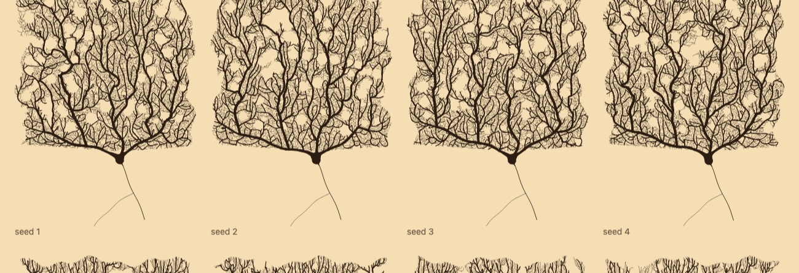

# cajal

Purkinje cells in the style of Santiago Ramón y Cajal's ink drawings, generated in OCaml.



Each seed grows a different cell. Growth is simulated roughly the way real dendrites grow:

- **Growth cones** wander upward in long arcs, push away from the cell's own branches (self-avoidance) and fork now and then where there is room.
- **Joins:** a dendrite that runs into another joins it, which closes the rounded loops in Cajal's drawings.
- **Sprouting:** new branches sprout from the sides of existing dendrites into whatever space is left.
- **Fine branchlets:** a late phase of short, wiry branchlets fills the gaps.
- **Line weight** follows a flattened pipe model, so the trunks are only somewhat heavier than the branches they feed. Each dendrite tapers only near its tip.
- **The soma** grows out of the primary trunks rather than being drawn separately. It is the smooth union of the trunks' tapering bases with a squat belly and the axon hillock, traced from a distance field.

Everything is a pure function of the seed. Randomness is a hash of a path of keys, and the growth loop is a recursion over immutable maps. The same seed always draws the same cell.

## Usage

You need OCaml (4.14 or later) and dune. There are no other dependencies.

```sh
dune build
dune exec cajal -- --seed 7 -o cell.svg                 # one cell
dune exec cajal -- --seed 7 --ink indigo > cell.svg     # inks: sepia (default), forest, indigo
dune exec cajal -- --gallery out --from 1 --count 12    # out/seed-*.svg and out/index.html
```

A cell takes about half a second and comes out as an SVG of roughly 500 KB.

You can also use the library directly: `Cajal.Purkinje.draw ?ink seed` returns the SVG document as a string.

## Files

- `src/purkinje.ml` is the growth simulation and the drawing.
- `src/sketch.ml` holds the seeded randomness, plane geometry and SVG helpers.
- `bin/main.ml` is the command-line tool.

The look it aims at is that of Cajal's drawings of Purkinje cells, now held at the Instituto Cajal in Madrid.

## License

MIT; see [LICENSE](LICENSE).
